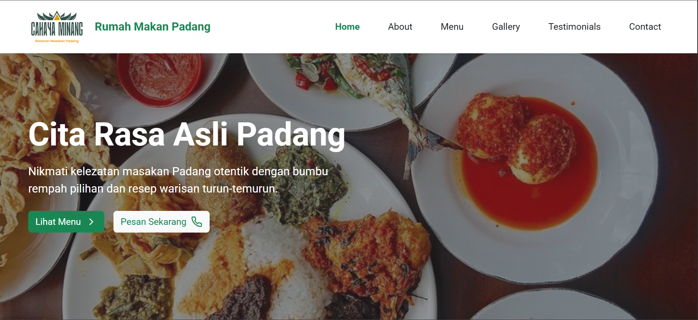

# Rumah Makan Padang

A profile and menu website for a Padang restaurant, built with React.js. Created as a final project for the Web Programming course at Universitas Bengkulu. Developed as a team project, where I served as the team lead.

**Demo:** [https://rahmahf074.github.io/rumah-makan-padang-react/]



## Features

- Single-page layout featuring Hero, About, Menu, Gallery, Testimonials, and Contact sections
- Card-based menu list with separated data in `src/data/menuItems.js`
- Photo gallery and customer testimonials
- Contact form
- Responsive navigation with a mobile menu
- Active navigation link highlighting on scroll

## Tech Stack

- React.js (Create React App)
- CSS
- GitHub Pages / Vercel for deployment

## Running Locally

Prerequisites: Node.js 18 or newer.

```bash
git clone [https://github.com/Rahmahf074/](https://github.com/Rahmahf074/)[FILL: new-repo-name].git
cd [FILL: new-repo-name]
npm install
npm start
